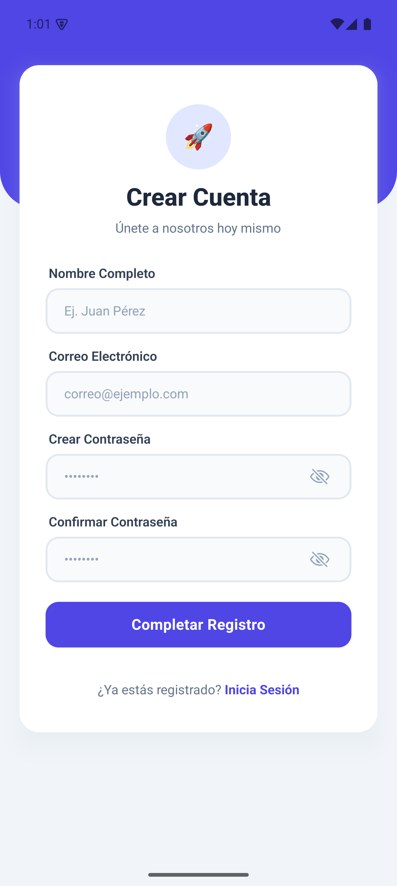
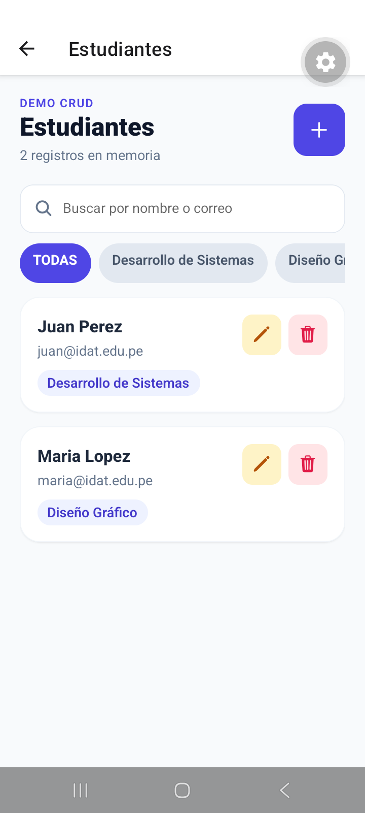
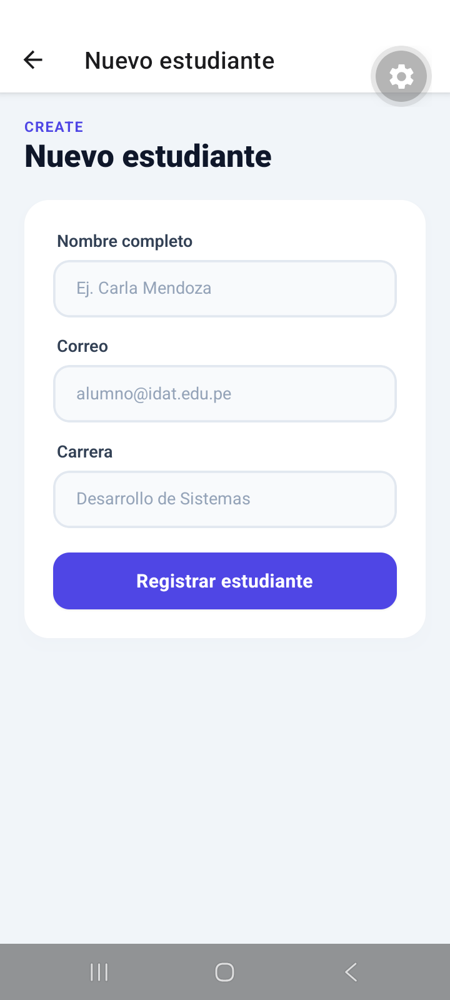
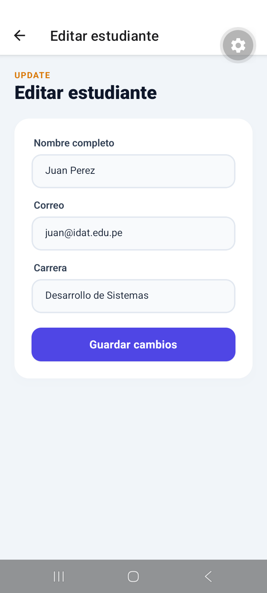
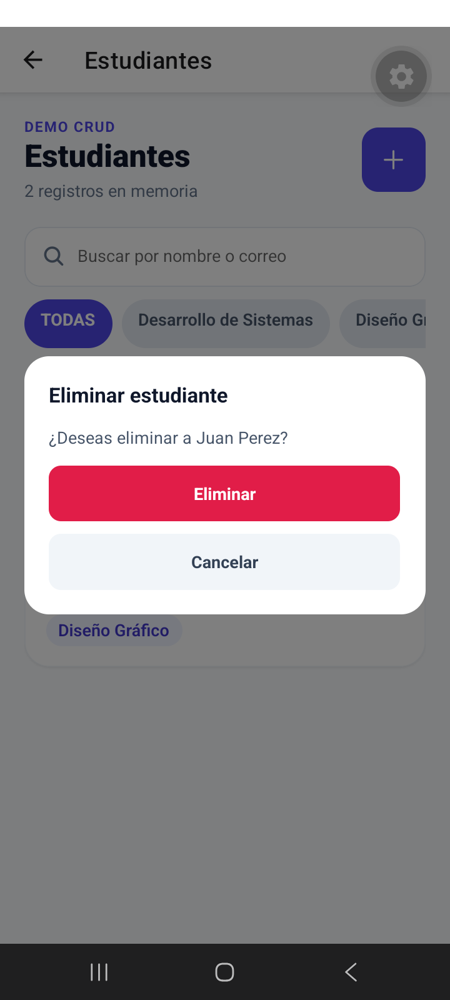

# Aplicación de inicio de sesión y demo CRUD

Aplicación móvil de ejemplo creada con **Expo**, **React Native**, **Expo Router** y **NativeWind**. Incluye pantallas de inicio de sesión, registro, un panel de bienvenida y una demo CRUD de estudiantes en memoria. Está pensada como una práctica de formularios, validación, componentes reutilizables, navegación y manejo de estado compartido.

## Funcionalidades

- Inicio de sesión con validación de correo y contraseña.
- Registro con campos para nombre, correo, contraseña y confirmación.
- Navegación entre las pantallas mediante Expo Router.
- Panel de bienvenida y acción para cerrar sesión.
- CRUD de estudiantes: crear, listar, editar y eliminar con confirmación.
- Búsqueda de estudiantes por nombre o correo y filtro por carrera.
- Interfaz adaptable a dispositivos móviles y web.

## Credenciales de demostración

Usa estos datos en la pantalla de inicio de sesión:

| Campo | Valor |
| --- | --- |
| Correo | `admin@edu.pe` |
| Contraseña | `admin123` |

El formulario requiere que el correo contenga `@` y que la contraseña tenga al menos seis caracteres. Solo las credenciales de demostración anteriores permiten entrar al panel.

## Demo CRUD de estudiantes

Después de iniciar sesión, pulsa **Ir a Estudiantes** en el panel principal para abrir la demo. El listado incluye dos estudiantes de ejemplo: Juan Perez y Maria Lopez.

1. **Listar:** consulta el nombre, correo y carrera de cada estudiante. Usa el buscador para encontrar registros por nombre o correo y los filtros para seleccionar una carrera; **TODAS** muestra todas las carreras.
2. **Crear:** pulsa el botón **+**, completa nombre, correo y carrera y selecciona **Registrar estudiante**.
3. **Editar:** pulsa el icono de lápiz de un estudiante, modifica sus datos y guarda los cambios.
4. **Eliminar:** pulsa el icono de papelera y confirma con **Eliminar**, o selecciona **Cancelar** para conservar el registro.

El formulario exige un nombre de al menos tres caracteres, un correo válido y una carrera obligatoria.

Los datos se comparten mediante Context y `useReducer` y se guardan **solo en memoria**, sin base de datos ni API. Una recarga completa de la aplicación descarta los cambios y restablece los dos estudiantes iniciales.

## Requisitos

- Node.js
- npm

## Instalación y ejecución

```bash
npm install
npx expo start
```


## Estructura principal

```text
src/
├── app/                 # Rutas y pantallas de Expo Router
│   └── estudiantes/     # Listado, creación y edición de estudiantes
├── domain/
│   └── entities/        # Tipos de datos del estudiante
└── presentation/
    ├── components/      # Componentes de interfaz
    ├── context/         # Estado compartido del CRUD en memoria
    ├── hooks/           # Estado, validación y acciones de formularios
    └── reducers/        # Operaciones sobre la lista de estudiantes
```

## Capturas de pantalla

Las siguientes capturas muestran las pantallas principales en formato móvil:

### Inicio de sesión


### Registro



### Panel principal


Las capturas del CRUD se tomaron en un teléfono Android (Samsung Galaxy A06) con Expo Go.

### CRUD: listado de estudiantes

Listado con búsqueda por nombre o correo y filtros por carrera.



### CRUD: crear estudiante

Formulario para registrar el nombre, correo y carrera de un estudiante.



### CRUD: editar estudiante

Formulario con los datos del estudiante y la opción de guardar cambios.



### CRUD: eliminar estudiante

Confirmación antes de eliminar un registro del listado.


