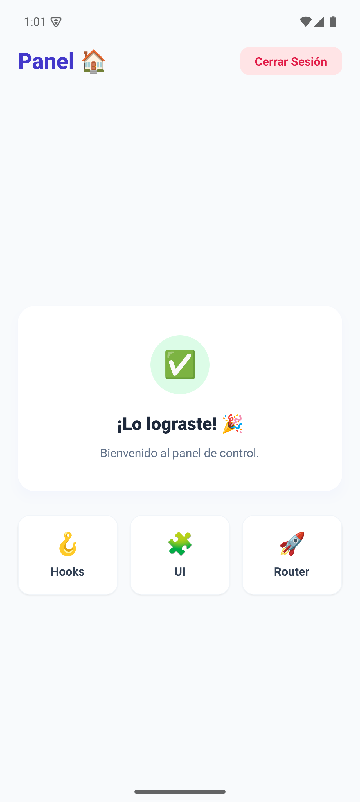

# Aplicación de inicio de sesión

Aplicación móvil de ejemplo creada con **Expo**, **React Native**, **Expo Router** y **NativeWind**. Incluye pantallas de inicio de sesión, registro y un panel de bienvenida. Está pensada como una práctica de formularios, validación, componentes reutilizables y navegación.


## Funcionalidades

- Inicio de sesión con validación de correo y contraseña.
- Registro con campos para nombre, correo, contraseña y confirmación.
- Navegación entre las pantallas mediante Expo Router.
- Panel de bienvenida y acción para cerrar sesión.
- Interfaz adaptable a dispositivos móviles y web.

## Credenciales de demostración

Usa estos datos en la pantalla de inicio de sesión:

| Campo | Valor |
| --- | --- |
| Correo | `admin@edu.pe` |
| Contraseña | `admin123` |

El formulario requiere que el correo contenga `@` y que la contraseña tenga al menos seis caracteres. Solo las credenciales de demostración anteriores permiten entrar al panel.

## Requisitos

- Node.js
- npm

## Instalación y ejecución

```bash
npm install
npx expo start
```


## Estructura principal

```text
src/
├── app/                 # Rutas y pantallas de Expo Router
└── presentation/
    ├── components/      # Componentes de interfaz
    └── hooks/           # Estado, validación y acciones de formularios
```

## Capturas de pantalla

Las siguientes capturas muestran las pantallas principales en formato móvil:

### Inicio de sesión


### Registro


### Panel principal


