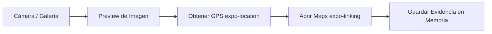
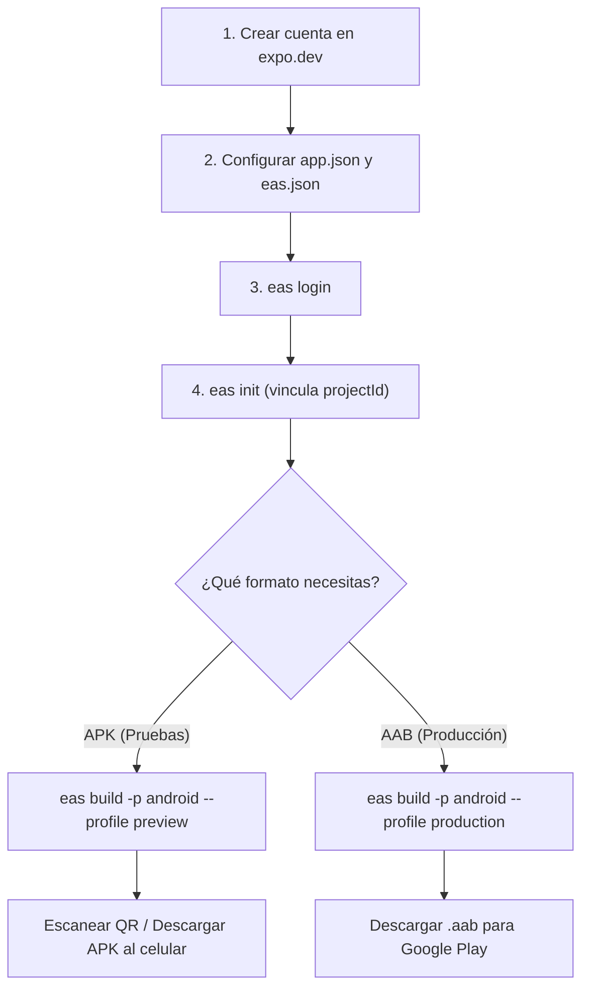
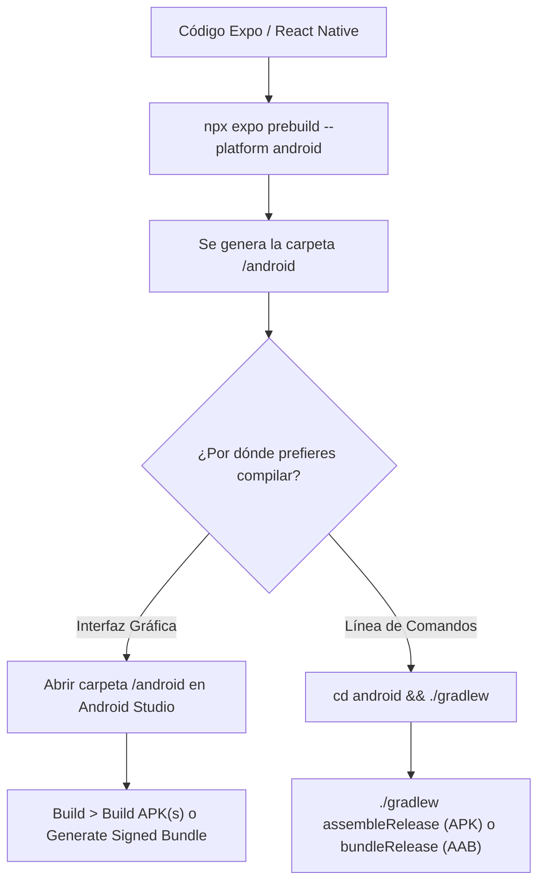

<div align="center">

| <a target="_blank" href="https://reactnative.dev/"></a> | <a target="_blank" href="https://docs.expo.dev/"></a> |
|:---:|:---:|
| **[Documentación React Native](https://reactnative.dev/)** | **[Documentación Expo](https://docs.expo.dev/)** |

# 📱 Curso de Desarrollo Móvil con React Native & Expo 2026
### *Semana 10: Sensores Nativos, Mapas, Persistencia SQLite y Generación de Builds (APK & AAB)*


</div>

---

## 📑 Tabla de Contenidos

1. [Visión General del Repositorio](#-visión-general-del-repositorio)
2. [Entorno de Desarrollo y Requisitos Previos](#-entorno-de-desarrollo-y-requisitos-previos)
3. [Estructura y Proyectos del Repositorio (Semana 10)](#-estructura-y-proyectos-del-repositorio-semana-10)
   - [Proyecto 1: Dispositivo y Build (Cámara, GPS, Galería, Enlaces)](#1-demo-device-build-maqueta-alumnos-sdk58)
   - [Proyecto 2: Google Maps y Geolocalización en Tiempo Real](#2-demo-google-maps-maqueta-alumnos-sdk58)
   - [Proyecto 3: Notas con Foto y Persistencia Relacional en SQLite](#3-demo-photo-notes-persistencia-maqueta-alumnos-sdk58)
4. [Fundamentos: ¿Qué es un APK y qué es un AAB?](#-fundamentos-qué-es-un-apk-y-qué-es-un-aab)
5. [Guía Didáctica 1: Generación de APK y AAB con Expo EAS (Nube)](#-guía-didáctica-1-generación-de-apk-y-aab-con-expo-eas-en-la-nube)
6. [Guía Didáctica 2: Generación de APK y AAB con Android Studio y Gradle (Local)](#-guía-didáctica-2-generación-de-apk-y-aab-con-android-studio-y-gradle-compilación-local)
7. [Firma de la Aplicación (Keystore para Release)](#-firma-de-la-aplicación-keystore-para-release)
8. [Resolución de Problemas Frecuentes (Troubleshooting)](#-resolución-de-problemas-frecuentes-troubleshooting)
9. [Comandos de Verificación Rápida](#-comandos-de-verificación-rápida)

---

## 🎯 Visión General del Repositorio

Este repositorio contiene los proyectos prácticos correspondientes a la **Semana 10** del curso de desarrollo de aplicaciones móviles con **React Native** y **Expo (SDK 58)**. 

El objetivo principal es llevar a los alumnos desde la integración de hardware nativo y persistencia local bajo **Clean Architecture** hasta el ciclo completo de despliegue y distribución mediante la generación de binarios instalables (**APK**) y paquetes de producción para Google Play Store (**AAB**).

---

## 💻 Entorno de Desarrollo y Requisitos Previos

Antes de ejecutar cualquiera de los proyectos o generar compilaciones locales, asegúrate de tener tu equipo configurado con las herramientas esenciales:

### 1. Herramientas Base

| Herramienta | Versión Recomendada | Enlace Oficial | Propósito |
| :--- | :--- | :--- | :--- |
| **Node.js** | `v22.13.x` LTS o superior | [nodejs.org](https://nodejs.org/es/) | Motor de ejecución JavaScript para Expo CLI y Metro Bundler |
| **Git** | Última versión estable | [git-scm.com](https://git-scm.com/) | Control de versiones |
| **VS Code** | Última versión | [code.visualstudio.com](https://code.visualstudio.com/) | Editor de código principal |
| **Android Studio** | Ladybug / Koala o superior | [developer.android.com](https://developer.android.com/studio) | SDKs de Android, Emulador y compilación local con Gradle |
| **JDK (Java)** | OpenJDK 17 LTS | [adoptium.net (Temurin 17)](https://adoptium.net/) | Requerido por Gradle 8+ para compilar Android nativo |
| **Expo Go** | Compatible con SDK 58 | [Play Store](https://play.google.com/store/apps/details?id=host.exp.exponent) / [App Store](https://apps.apple.com/us/app/expo-go/id982107779) | Cliente de pruebas directas en teléfono físico |
| **Vysor** *(Opcional)* | Última versión | [vysor.io](https://www.vysor.io/) | Espejado y control de pantalla de tu celular Android por cable USB |

### 2. Configuración de Variables de Entorno (Crucial para Compilación Local)

Para que Android Studio y el comando `npx expo run:android` funcionen sin fallas, define las siguientes variables en tu sistema:

#### En macOS / Linux (`~/.zshrc` o `~/.bashrc`):
```bash
export JAVA_HOME=$(/usr/libexec/java_home -v 17)
export ANDROID_HOME=$HOME/Library/Android/sdk
export PATH=$PATH:$ANDROID_HOME/emulator
export PATH=$PATH:$ANDROID_HOME/platform-tools
export PATH=$PATH:$ANDROID_HOME/cmdline-tools/latest/bin
```

#### En Windows (Variables del Sistema):
- `JAVA_HOME`: `C:\Program Files\Eclipse Adoptium\jdk-17.x.x` (o ruta de tu JDK 17).
- `ANDROID_HOME`: `C:\Users\<TuUsuario>\AppData\Local\Android\Sdk`.
- Agregar al `Path`: `%ANDROID_HOME%\platform-tools` y `%ANDROID_HOME%\emulator`.

### 3. Extensiones Recomendadas para Visual Studio Code

- [Error Lens](https://marketplace.visualstudio.com/items?itemName=usernamehw.errorlens): Resalta errores sintácticos y de TypeScript al instante.
- [ES7 React/Redux/React-Native snippets](https://marketplace.visualstudio.com/items?itemName=dsznajder.es7-react-js-snippets): Atajos de código para componentes.
- [Tailwind CSS IntelliSense](https://marketplace.visualstudio.com/items?itemName=bradlc.vscode-tailwindcss): Autocompletado para clases NativeWind.
- [Pretty TypeScript Errors](https://marketplace.visualstudio.com/items?itemName=yoavbls.pretty-ts-errors): Formatea los mensajes de error de TypeScript para fácil lectura.

---

## 📂 Estructura y Proyectos del Repositorio (Semana 10)

El repositorio se divide en tres proyectos autónomos basados en **Clean Architecture** (separación estricta entre presentación, dominio e infraestructura):

```text
React-native-expo-clas/
├── demo-device-build-maqueta-alumnos-sdk58/          # Proyecto 1: Sensores y Build
├── demo-google-maps-maqueta-alumnos-sdk58/           # Proyecto 2: Google Maps Nativo
├── demo-photo-notes-persistencia-maqueta-alumnos-sdk58/ # Proyecto 3: SQLite y Fotos
└── readme.md                                         # Este manual central
```

Cada proyecto implementa la siguiente arquitectura por capas:
- `app/`: Enrutamiento declarativo con **Expo Router** y punto de inyección de dependencias.
- `src/presentation/`: Pantallas, componentes visuales e interfaz de usuario estilizada con **NativeWind**.
- `src/domain/`: Modelos de negocio (entidades) y contratos (interfaces) de servicios y repositorios.
- `src/infrastructure/`: Implementaciones concretas que consumen las APIs nativas del dispositivo o bases de datos.

---

### 1. `demo-device-build-maqueta-alumnos-sdk58`
> **Enfoque:** Integración de hardware nativo (Cámara, Galería, GPS, Enlaces a Mapas) y generación del primer APK de pruebas.



- **Módulos utilizados:** `expo-image-picker`, `expo-location`, `expo-linking`.
- **Archivo principal a completar por el alumno:**
  ```text
  src/infrastructure/services/deviceService.ts
  ```
- **Tareas pendientes (TODOs):**
  1. `requestCameraPermissionsAsync` y `launchCameraAsync` para captura fotográfica.
  2. `requestMediaLibraryPermissionsAsync` y `launchImageLibraryAsync` para selección desde la galería.
  3. `requestForegroundPermissionsAsync` y `getCurrentPositionAsync` para geolocalización.
  4. `Linking.openURL` para abrir la ubicación en Google Maps externo:
     ```text
     https://www.google.com/maps/search/?api=1&query=LATITUD,LONGITUD
     ```
- **Cómo ejecutarlo:**
  ```bash
  cd demo-device-build-maqueta-alumnos-sdk58
  npm ci
  npm start
  ```

---

### 2. `demo-google-maps-maqueta-alumnos-sdk58`
> **Enfoque:** Integración de mapas interactivos vectoriales con soporte nativo y permisos de localización en tiempo real.

- **Módulos utilizados:** `expo-maps` / `react-native-maps`, `expo-location`.
- **Requisito clave:** Requiere una clave de API válida de **Google Maps SDK for Android**.
- **Configuración de Google Cloud Console:**
  1. Ingresa a [Google Cloud Console](https://console.cloud.google.com/).
  2. Crea un proyecto y activa el servicio **Maps SDK for Android**.
  3. Genera una credencial (API Key).
  4. Restringe la clave al nombre de paquete (`android.package`):
     ```text
     com.albin.semana10mapsalumnos
     ```
  5. Asocia la huella digital SHA-1 de tu certificado de desarrollo o de EAS Build.
  6. Coloca tu clave en `app.json`:
     ```json
     "android": {
       "package": "com.albin.semana10mapsalumnos",
       "config": {
         "googleMaps": {
           "apiKey": "AIzaSyTuClaveRealDeGoogleMaps..."
         }
       }
     }
     ```
- **Cómo ejecutarlo:**
  ```bash
  cd demo-google-maps-maqueta-alumnos-sdk58
  npm ci
  npm start
  ```
  > [!NOTE]
  > Los mapas nativos de Google Maps requieren código binario nativo de Android. En Expo Go se muestra una maqueta de emulación; para visualizar el renderizado nativo completo de Google Maps debes compilar un APK con EAS o Android Studio.

---

### 3. `demo-photo-notes-persistencia-maqueta-alumnos-sdk58`
> **Enfoque:** Persistencia de datos relacionales sin conexión (Offline-first) con SQLite y vinculación de archivos fotográficos.

- **Módulos utilizados:** `expo-sqlite`, `expo-image-picker`.
- **Características principales:**
  - Base de datos relacional local embebida mediante SQLite.
  - Almacena títulos, descripciones, marcas de tiempo y la **URI local** de la imagen capturada.
  - Implementa el patrón Repository para operaciones CRUD completas (crear nota, listar registros, eliminar notas).
  - Compatible con pruebas locales en entorno Web (utilizando SQLite WebAssembly).
- **Cómo ejecutarlo:**
  ```bash
  cd demo-photo-notes-persistencia-maqueta-alumnos-sdk58
  npm ci
  npm start
  ```

---

## 📦 Fundamentos: ¿Qué es un APK y qué es un AAB?

Antes de generar tus archivos, comprende la diferencia fundamental entre ambos formatos:

| Característica | APK (Android Package Kit) | AAB (Android App Bundle) |
| :--- | :--- | :--- |
| **Propósito Principal** | Pruebas directas, distribución manual y QA | Publicación oficial en Google Play Store |
| **Instalación Directa** | **Sí**, se puede instalar en cualquier teléfono vía cable USB, WhatsApp, Drive o descarga directa | **No**, el dispositivo no lo entiende directamente; Google Play lo procesa primero |
| **Tamaño del Archivo** | Mayor (incluye recursos y binarios para todas las arquitecturas de CPU: arm64, armeabi, x86) | Optimizado y compacto |
| **Firma Digital** | Puede usar firma de Debug o Release | Debe estar firmado con un Keystore de producción |
| **Perfil en `eas.json`** | `"buildType": "apk"` (Perfil `preview`) | `"buildType": "app-bundle"` (Perfil `production`) |

```text
       ┌─────────── Código React Native + Assets ───────────┐
       │                                                    │
       ▼                                                    ▼
   [ Modo APK ]                                        [ Modo AAB ]
Descarga e instala en el celular             Sube a Google Play Console
(Pruebas de alumnos y docentes)             (Google genera APKs optimizados por dispositivo)
```

---

## ☁️ Guía Didáctica 1: Generación de APK y AAB con Expo EAS (En la Nube)

**Expo Application Services (EAS Build)** es la forma más rápida y recomendada. Compila tu aplicación en los servidores seguros de Expo en la nube, sin necesidad de consumir memoria RAM ni configurar Android Studio localmente.

### Diagrama del Flujo EAS


---

### Paso 1: Configurar el Identificador de Paquete en `app.json`

Abre el archivo `app.json` del proyecto elegido y verifica que exista un `package` único dentro de la sección `android`:

```json
{
  "expo": {
    "name": "demo-device-build-maqueta-alumnos",
    "slug": "demo-device-build-maqueta-alumnos",
    "version": "1.0.0",
    "android": {
      "package": "com.tu_nombre_o_codigo.demodevicebuild",
      "edgeToEdgeEnabled": true
    }
  }
}
```

> [!IMPORTANT]
> El identificador `android.package` debe tener formato de dominio invertido (por ejemplo: `com.tunombre.miapp`) y no debe contener caracteres especiales ni guiones.

---

### Paso 2: Configurar `eas.json`

Verifica que el archivo `eas.json` en la raíz del proyecto tenga configurados los perfiles `preview` (para APK) y `production` (para AAB):

```json
{
  "cli": {
    "version": ">= 16.0.0"
  },
  "build": {
    "preview": {
      "android": {
        "buildType": "apk"
      }
    },
    "production": {
      "android": {
        "buildType": "app-bundle"
      }
    }
  }
}
```

---

### Paso 3: Instalar EAS CLI e Iniciar Sesión

Abre tu terminal dentro de la carpeta del proyecto que deseas compilar:

```bash
# 1. Instalar la herramienta globalmente (solo una vez)
npm install -g eas-cli

# 2. Iniciar sesión con tu cuenta de Expo (regístrate gratis en expo.dev si no tienes cuenta)
eas login
```

---

### Paso 4: Vincular el Proyecto con tu Cuenta de Expo

```bash
eas init
```
- EAS detectará tu cuenta y te preguntará si deseas crear un nuevo proyecto en Expo.
- Presiona `Yes`.
- Esto agregará automáticamente un `projectId` único en tu `app.json`.

---

### Paso 5: Generar el APK de Prueba (Perfil Preview)

Ejecuta el siguiente comando:

```bash
eas build -p android --profile preview
```

**¿Qué sucederá durante el proceso?**
1. EAS empaquetará tu código JavaScript y assets.
2. Te preguntará si deseas que Expo gestione la clave de firma (*Keystore*). Selecciona **Yes** (recomendado).
3. Subirá el bundle a los servidores de compilación de Expo.
4. En la terminal verás un enlace web para monitorear el progreso del build.
5. Al finalizar (toma entre 5 a 12 minutos), la terminal mostrará un **código QR** y una URL directa para descargar el archivo `.apk`.
6. Escanea el código QR con tu celular Android o abre el enlace en tu navegador móvil, descarga el archivo e instálalo.

---

### Paso 6: Generar el AAB de Producción (Perfil Production)

Cuando la aplicación esté lista para ser subida a Google Play Console:

```bash
eas build -p android --profile production
```

- Este comando compilará un paquete en formato `.aab`.
- Al finalizar, descarga el archivo `.aab` desde el panel web de [expo.dev](https://expo.dev) y súbelo a la consola de Google Play en la sección de Pruebas Internas o Producción.

---

## 🛠️ Guía Didáctica 2: Generación de APK y AAB con Android Studio y Gradle (Compilación Local)

Si necesitas compilar sin conexión a internet, sin gastar minutos de la nube de Expo o para depurar código nativo en Java/Kotlin, puedes compilar localmente con Android Studio.

### Diagrama del Flujo Local (Prebuild + Gradle)


---

### Paso 1: Generar la Carpeta Nativa de Android (`Prebuild`)

Por defecto, los proyectos de Expo están en modo *Managed* (no contienen la carpeta `android/`). Para generar todo el proyecto nativo de Android Studio, ejecuta:

```bash
npx expo prebuild --platform android
```

> [!NOTE]
> Este comando lee tu `app.json`, resuelve todos los plugins (cámara, ubicación, permisos) y crea la carpeta nativa `android/` con su `AndroidManifest.xml`, código Java/Kotlin y scripts de Gradle.

---

### Paso 2: Abrir el Proyecto en Android Studio

1. Abre **Android Studio**.
2. Selecciona **Open** (Abrir).
3. **MUY IMPORTANTE:** Navega hasta tu proyecto y selecciona **únicamente la carpeta `android/`** (por ejemplo: `demo-device-build-maqueta-alumnos-sdk58/android`). No abras la carpeta raíz de JavaScript.
4. Espera a que Android Studio descargue las dependencias y finalice el **Gradle Sync** (observarás la barra de progreso en la esquina inferior derecha).

---

### Opción A: Compilar mediante la Interfaz Gráfica de Android Studio

#### 1. Generar APK (Debug o Release sin firmar):
1. En el menú superior, ve a: **Build** > **Build Bundle(s) / APK(s)** > **Build APK(s)**.
2. Android Studio comenzará a compilar la aplicación.
3. Al terminar, aparecerá una notificación flotante en la esquina inferior derecha con el mensaje *Build APK(s) successfully*. Haz clic en **locate**.
4. Encontrarás el archivo generado en:
   ```text
   android/app/build/outputs/apk/debug/app-debug.apk
   ```

#### 2. Generar AAB o APK Firmado para Producción:
1. En el menú superior, ve a: **Build** > **Generate Signed Bundle / APK...**
2. Selecciona:
   - **Android App Bundle** (para generar `.aab` para Google Play).
   - **APK** (para generar un `.apk` firmado de producción).
3. Haz clic en **Next**.
4. En **Key store path**, selecciona tu llave existente o crea una nueva haciendo clic en **Create new...** (revisa la sección de Keystore más adelante).
5. Ingresa las contraseñas, selecciona el alias de la llave y presiona **Next**.
6. Selecciona la variante de compilación: **release**.
7. Haz clic en **Finish**.
8. El archivo se generará en:
   - Para AAB: `android/app/release/app-release.aab` (o en `android/app/build/outputs/bundle/release/`).
   - Para APK: `android/app/release/app-release.apk`.

---

### Opción B: Compilar desde la Terminal con Gradle Wrapper (Más Rápido)

Puedes compilar directamente desde tu terminal sin abrir la interfaz pesada de Android Studio:

```bash
# Entra en la carpeta nativa
cd android
```

#### Para generar un APK de pruebas (Debug):
```bash
# En macOS / Linux:
./gradlew assembleDebug

# En Windows:
gradlew.bat assembleDebug
```
📍 **Ubicación del APK generado:**
`android/app/build/outputs/apk/debug/app-debug.apk`

#### Para generar un APK optimizado (Release):
```bash
# En macOS / Linux:
./gradlew assembleRelease

# En Windows:
gradlew.bat assembleRelease
```
📍 **Ubicación del APK generado:**
`android/app/build/outputs/apk/release/app-release-unsigned.apk`

#### Para generar un AAB (Android App Bundle para Google Play):
```bash
# En macOS / Linux:
./gradlew bundleRelease

# En Windows:
gradlew.bat bundleRelease
```
📍 **Ubicación del AAB generado:**
`android/app/build/outputs/bundle/release/app-release.aab`

---

## 🔐 Firma de la Aplicación (Keystore para Release)

Google Play exige que todas las aplicaciones estén firmadas digitalmente por el desarrollador para garantizar su autenticidad e integridad.

### 1. Generar tu Llave Criptográfica (`.keystore` o `.jks`)

Ejecuta el siguiente comando en tu terminal (utiliza la herramienta `keytool` que viene incluida con Java):

```bash
keytool -genkeypair -v -storetype PKCS12 -keystore mi-llave-release.keystore -alias mi-alias -keyalg RSA -keysize 2048 -validity 10000
```

El asistente te solicitará:
1. Una contraseña segura (guárdala muy bien).
2. Tus datos básicos (Nombre, Organización, Ciudad, País).
3. Confirmar con `sí` o `yes`.

Se creará el archivo `mi-llave-release.keystore`.

> [!CAUTION]
> Guarda este archivo y tu contraseña en un lugar seguro. Si pierdes tu Keystore, **no podrás actualizar tu aplicación en Google Play Store jamás** y tendrás que publicarla con otro identificador.

---

## 🔧 Resolución de Problemas Frecuentes (Troubleshooting)

### 1. Error: `JAVA_HOME is not set` o incompatibilidad de versión de Java
- **Causa:** Gradle requiere JDK 17 para compilar proyectos con React Native 0.88 y SDK 58.
- **Solución:**
  - Verifica tu versión con `java -version`.
  - Asegúrate de tener instalado Java 17 (OpenJDK / Temurin).
  - En macOS: `export JAVA_HOME=$(/usr/libexec/java_home -v 17)`.
  - En Windows: Ajusta la variable del sistema `JAVA_HOME` apuntando al directorio de instalación de tu JDK 17.

---

### 2. Error: `Permission denied: ./gradlew` (macOS / Linux)
- **Causa:** El script `gradlew` no tiene permisos de ejecución en sistemas Unix.
- **Solución:** Ejecuta en la terminal:
  ```bash
  chmod +x android/gradlew
  ```

---

### 3. Error en EAS: `Android package name is missing`
- **Causa:** No se configuró el campo `"package"` en el archivo `app.json`.
- **Solución:** Agrega la propiedad dentro de la sección `"android"`:
  ```json
  "android": {
    "package": "com.tucolegio.tuproyecto"
  }
  ```

---

### 4. Google Maps se ve en gris o con cuadrícula vacía en Android
- **Causa:** La API Key de Google Maps no es válida, no tiene habilitada la API **Maps SDK for Android**, o sus restricciones de huella digital SHA-1 no coinciden con la firma del APK.
- **Solución:**
  1. Verifica en Google Cloud Console que **Maps SDK for Android** esté en estado **Habilitado**.
  2. Obtén la huella SHA-1 de tu keystore ejecutando:
     ```bash
     keytool -list -v -keystore ~/.android/debug.keystore -alias androiddebugkey -storepass android -keypass android
     ```
  3. Agrega dicha huella SHA-1 y el paquete `com.albin.semana10mapsalumnos` en las restricciones de tu API Key en Google Cloud.

---

### 5. Error de compilación tras modificar librerías (`Clean Cache`)
- **Solución:** Limpia la caché de Metro Bundler y Gradle:
  ```bash
  # Limpiar caché de Expo
  npx expo start -c

  # Limpiar caché de Gradle
  cd android
  ./gradlew clean
  cd ..
  ```

---

## ⚡ Comandos de Verificación Rápida

Antes de enviar tus proyectos a compilación o entrega, valida que el código no tenga errores de dependencias, tipos o estilos:

```bash
# 1. Verificar compatibilidad de dependencias de Expo SDK 58
npx expo install --check

# 2. Comprobar que no existan errores de tipos en TypeScript
npx tsc --noEmit

# 3. Analizar el código en busca de errores con ESLint
npm run lint
```

---

<div align="center">

**IDAT — Escuela de Tecnología · 2026**  
*Desarrollo de Aplicaciones Móviles con React Native y Expo*

</div>
